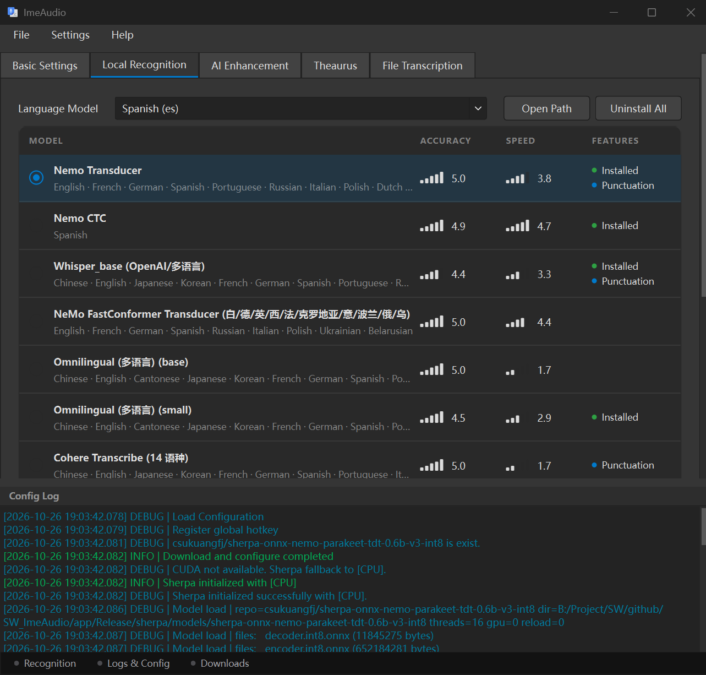

# ImeAudio

ImeAudio 是一款高性能、AI 驱动的实时语音转录与文本润色工具。旨在为用户提供无缝的工作流体验，通过结合顶尖的本地与云端语音识别引擎，将您的语音瞬间转化为精准、优雅的文字。

## 🌟 核心功能

  

### 🎙️ 智能语音转录
* **多引擎支持：** 支持本地 **Sherpa** 引擎，或使用 **Gemini**、**Groq**、**Gladia** 等高性能云端引擎。
* **多语种识别：** 本地模型覆盖 100 多种语言等模型，可在「本地识别」页按语言挑选。
* **实时字幕：** 说话时悬浮窗边说边显示识别中的文字，可在设置页开关。
* **智能语音检测 (VAD)：** 自动识别语音片段，实现高效、精准的录音与处理。
* **实时频谱可视化：** 基于 FFT 的精美频谱与波形动画，实时反馈音频状态。
* **文件转录：** 批量导入音频文件转写为文字，逐段预览，可导出 txt 或字幕格式（带时间戳）。

### ✨ AI 文本精炼
* **智能润色：** 利用大语言模型 (LLM) 自动修复语法、调整语气或重新编排文本。
* **本地翻译：** 支持下载本地翻译模型，润色与翻译已拆分为独立功能（本地翻译仍在完善中）。
* **高度自定义：** 支持自定义 Prompt、专业 AI 词库以及文本替换规则。
* **术语管理：** 内置 `Terms Library`（术语库），确保专业词汇转录的准确性。

### 🛠️ 无缝工作流
* **全局热键：** 支持通过快捷键随时随地触发转录，也可设置「按住说话」，不中断现有操作。
* **现代化 UI/UX：** 基于 Qt Widgets 构建，拥有类似 macOS 的精致界面、平滑动画与现代审美；支持浅色、灰色、深色主题。
* **后台运行：** 轻量级系统托盘集成，托盘菜单可快速操作，实现静默高效工作。
* **识别记录：** 保存每次识别结果，表头可一次复制全部记录。
* **单实例运行：** 重复打开时直接唤出已运行的窗口。
* **即时生效：** 设置改动立即生效；录音进行中设置页会暂时锁定，避免中途修改配置。
* **自动更新：** 内置自动更新机制，始终保持功能最新。

## 🚀 快速开始

### 支持平台
* 💻 Windows (当前稳定版)
* 🍎 macOS (功能已完整)
* 🐧 Linux (计划中)

### 环境要求
* 网络连接 (使用云端 API 时需要)

### 安装步骤
1. 从 [Releases](#) 页面下载最新版本。
2. 运行安装程序或解压便携版。
3. 在设置菜单中配置您的 API 密钥。

## ⚙️ 配置说明
* **引擎选择：** 本地引擎 vs 云端引擎，本地识别页可按语言选择模型
* **API 凭据：** Gemini, Groq, Gladia 等，可在设置中直接测试 Key 是否可用。
* **实时字幕：** 在设置页开关，支持中、英、韩、法等流式语言。
* **UI 主题：** 明亮、黑暗、灰色或跟随系统。
* **语音规则：** 自定义词库（键值卡片形式）与润色风格。

## 🛠 技术栈
* **框架:** Qt 6 (C++/Widgets)
* **音频采集:** Qt Multimedia (QAudioSource)
* **音频解码:** FFmpeg（文件转录）
* **全局热键:** QHotkey
* **数字信号处理 (DSP):** KissFFT
* **AI 引擎:** sherpa-onnx (本地), Gemini, Groq, Gladia, OpenAI
* **本地翻译:** 独立 worker 进程，通过行协议与主程序通信

## 📄 开源协议
基于 AGPL v3 协议发布。详见 `LICENSE.txt`。
